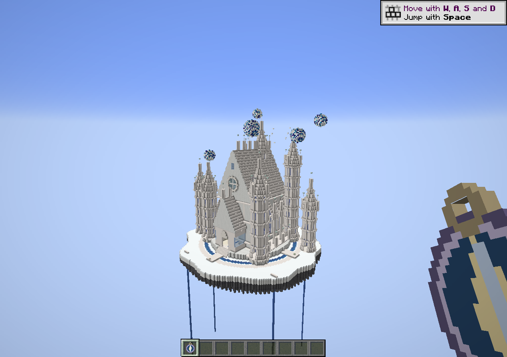
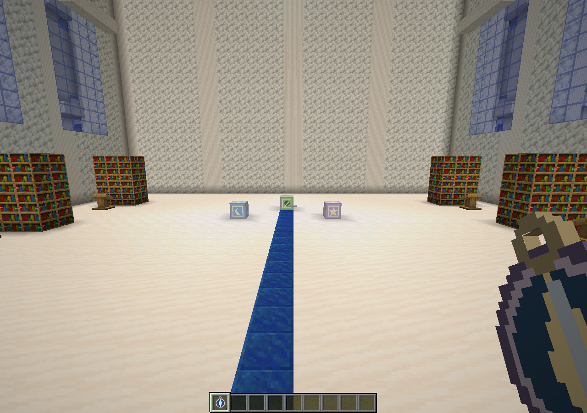

> **이전 버전의 기록입니다. 0.6.0부터 하늘 정원 콘텐츠는 종료했으며 신규 입장·생성을 지원하지 않습니다.**

# 화이트 천공 성채 — 0.5.2 건축 시안

사용자가 제공한 건축 이미지에서 **백색 성채·높이가 다른 첨탑·급경사 지붕·깊은 창문과 아치·푸른 구체·절벽 아래 물줄기**를 디자인 기준으로 삼았습니다. 배치는 이 프로젝트에서 새로 작성했습니다.

이 버전은 중앙 성채의 조형을 실제 Minecraft에서 검토하고, 이후 실내와 주변 지역을 보완할 수 있도록 만든 시안입니다.

## 들어가기

서버와 접속자의 기존 JAR을 `sunlit-journal-core-0.5.2-dev.jar`로 교체하고 완전히 재시작합니다. 기존 별길 나침반을 일반 우클릭하면 새 공간으로 연결됩니다. 제작법은 자수정 4개·깃털 4개로 일반 나침반을 감싸는 기존 조합과 같습니다. 관리자 테스트용 명령은 `/give @s sunlit_journal_core:star_compass`입니다.

이전 작은 정원이나 확장 정원 안에 있다면 기존 귀환석·나침반·수첩으로 먼저 돌아온 뒤 다시 입장하세요. 기존 차원을 삭제하지 않으며 획득한 칭호·스킨·개인 기록도 유지합니다. 새 차원이 추가되므로 복사 월드에서 확인하는 것을 권장합니다.

## 이번에 만든 것

- 백색 섬과 짙은 광물 뿌리, 물길과 귀환 광장.
- 높이가 서로 다른 주탑·모서리탑·외곽 탑, 층별 돌출 띠와 작은 첨탑, 경사가 큰 지붕과 능선 장식.
- 본당의 깊은 창문, 뾰족한 창 테두리와 외벽 지지 구조, 정면 장미창, 넓은 계단과 낮은 입구 예배당.
- 크기와 높이가 다른 푸른 구체 다섯 개, 주변 결정 조각과 섬 아래로 내려가는 물줄기.
- 본당 열람 공간과 세 문양 장치. 개인별 기록·퍼즐·칭호·스킨 적용·귀환은 기존 기능과 연결됩니다.

기록석은 본당의 열람 공간과 물길 바깥의 좌우 회랑에 있습니다. 수첩의 비밀 기록에 힌트가 남으며 순서는 기존 달→잎→별입니다. 새 보상을 중복으로 지급하거나 기존 해금을 초기화하지 않습니다.

## 아직 완성 범위가 아닌 것

일부 높은 탑은 외관 조형이며 모든 층을 올라갈 계단과 방은 아직 없습니다. 주변 마을, 다채로운 개별 실내와 추가 의뢰도 이번 시안 범위에 포함하지 않았습니다. 먼저 대표 건물의 외관 방향을 확인하기 위한 버전입니다.

스크린샷은 실제 생성한 건축물의 기본 Minecraft 렌더링입니다. 셰이더로 원본 이미지의 조명/구름을 재현한 사진은 아닙니다. 촬영은 구름 끄기·렌더 거리 20에서 했으며 플레이어의 설정을 강제로 바꾸는 기능은 배포하지 않습니다.

## 확인한 기능

서버 GameTest 21개를 통과했으며, 실제 서버의 구조물·기록석·퍼즐·개인별 보상·저장/귀환 및 장비 원복 검사, 실제 클라이언트의 새 차원 입장·모델·기록/퍼즐·수첩·귀환을 검사합니다. 전체 모드팩/셰이더/Essential 다인 플레이와 모든 도보 동선을 확인한 것은 아닙니다.
