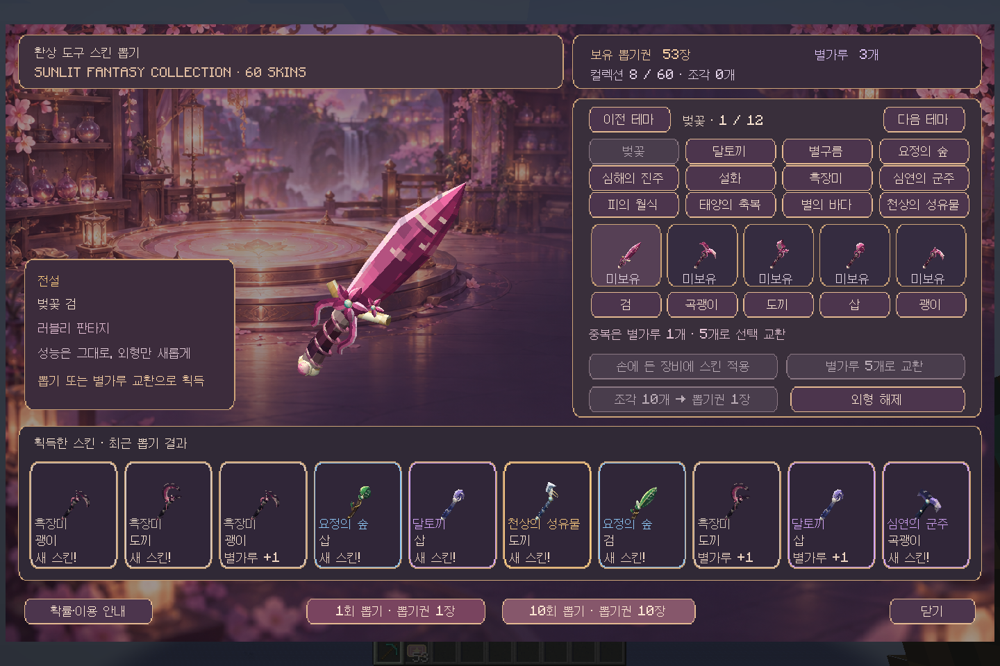
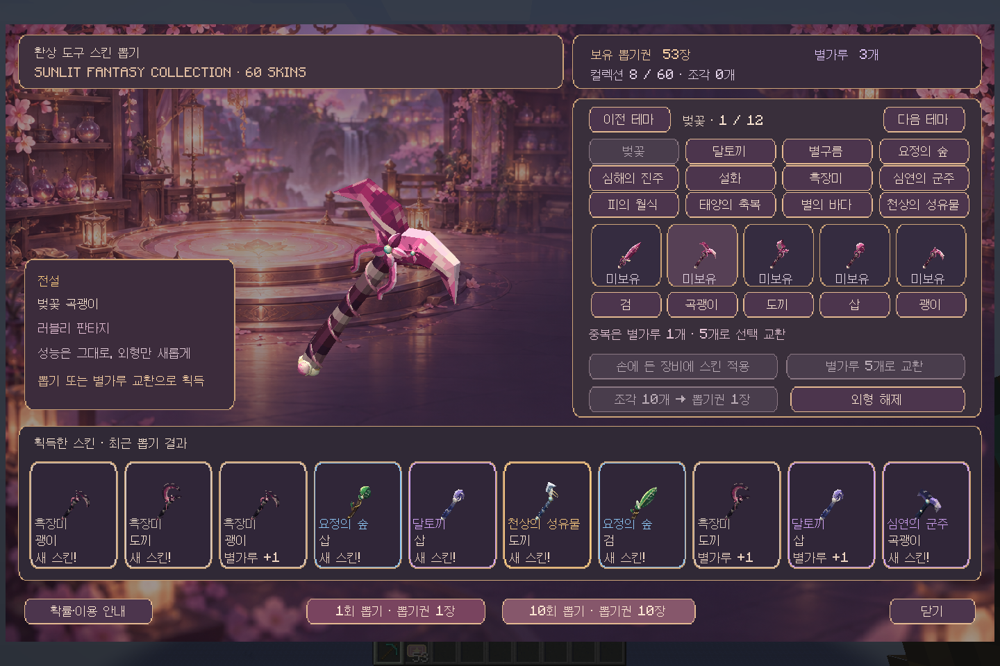

# Sunlit Fantasy · 60종 3D 스킨 컬렉션

0.6.2에서는 [픽셀 재질과 명암을 추가했습니다](PIXEL_MATERIALS.md).

0.6.1에서는 [테마별 몸체·그립 조형과 재질을 변경했습니다](SCULPTED_SKINS.md). 스킨 ID와 아래 확률은 동일합니다.

각 테마는 검·곡괭이·도끼·삽·괭이 5종으로 구성합니다. 실제 게임에서 사용하는 Forge OBJ 모델이며 추가 모델 로더 모드가 필요하지 않습니다.

| 컬렉션 | 테마 | 등급 | 각 도구 확률 | 테마 5종 합계 |
|---|---|---|---:|---:|
| 러블리 판타지 | 벚꽃 | 전설 | 0.3175% | 1.5873% |
| 러블리 판타지 | 달토끼 | 영웅 | 1.2698% | 6.3492% |
| 러블리 판타지 | 별구름 | 희귀 | 2.8571% | 14.2857% |
| 자연과 정령 | 요정의 숲 | 희귀 | 2.8571% | 14.2857% |
| 자연과 정령 | 심해의 진주 | 희귀 | 2.8571% | 14.2857% |
| 자연과 정령 | 설화 | 영웅 | 1.2698% | 6.3492% |
| 다크 판타지 | 흑장미 | 일반 | 3.4921% | 17.4603% |
| 다크 판타지 | 심연의 군주 | 영웅 | 1.2698% | 6.3492% |
| 다크 판타지 | 피의 월식 | 전설 | 0.3175% | 1.5873% |
| 신화와 천상 | 태양의 축복 | 전설 | 0.3175% | 1.5873% |
| 신화와 천상 | 별의 바다 | 희귀 | 2.8571% | 14.2857% |
| 신화와 천상 | 천상의 성유물 | 전설 | 0.3175% | 1.5873% |

확률은 정수 가중치 총합 630로 계산합니다. 표시는 소수점 넷째 자리에서 반올림하므로 표시 합계에 미세한 차이가 날 수 있습니다. 1회와 10회의 매회 확률은 동일하며 등급 보장·누적 확정 보상은 없습니다.

중복은 별가루 1개, 별가루 5개는 미보유 스킨 선택 교환입니다. 일일 업무 3개 완료로 얻는 **뽑기권 조각**과는 별도 재화입니다.

## 실제 게임 화면

## 모델 범위

승인한 시안의 꽃잎·리본·구름·토끼·나뭇잎·산호·눈꽃·장미·왕관·일식·날개·행성 장식을 게임용 곡면 메시로 단순화했습니다. 테마별 형태를 직접 생성하며 시안 이미지를 평면 아이템에 붙인 모델이 아닙니다. 표준 Minecraft 조명과 불투명 재질을 쓰므로 시안의 PBR 반사·반투명·후처리 효과를 그대로 재현하지 않습니다.

모델 파일: `assets/sunlit_journal_core/models/fantasy/<theme>/<kind>.obj`, 재질 파일: 같은 폴더 `materials.mtl`. 필요하면 Blender/Blockbench 등에서 OBJ를 열어 수작업으로 추가 조형할 수 있습니다.

## 전체 스킨 ID

| 테마 | 스킨 ID |
|---|---|
| 벚꽃 | `sakura_sword`, `sakura_pickaxe`, `sakura_axe`, `sakura_shovel`, `sakura_hoe` |
| 달토끼 | `moon_bunny_sword`, `moon_bunny_pickaxe`, `moon_bunny_axe`, `moon_bunny_shovel`, `moon_bunny_hoe` |
| 별구름 | `star_cloud_sword`, `star_cloud_pickaxe`, `star_cloud_axe`, `star_cloud_shovel`, `star_cloud_hoe` |
| 요정의 숲 | `fairy_forest_sword`, `fairy_forest_pickaxe`, `fairy_forest_axe`, `fairy_forest_shovel`, `fairy_forest_hoe` |
| 심해의 진주 | `deep_pearl_sword`, `deep_pearl_pickaxe`, `deep_pearl_axe`, `deep_pearl_shovel`, `deep_pearl_hoe` |
| 설화 | `snow_blossom_sword`, `snow_blossom_pickaxe`, `snow_blossom_axe`, `snow_blossom_shovel`, `snow_blossom_hoe` |
| 흑장미 | `black_rose_sword`, `black_rose_pickaxe`, `black_rose_axe`, `black_rose_shovel`, `black_rose_hoe` |
| 심연의 군주 | `abyss_sovereign_sword`, `abyss_sovereign_pickaxe`, `abyss_sovereign_axe`, `abyss_sovereign_shovel`, `abyss_sovereign_hoe` |
| 피의 월식 | `blood_eclipse_sword`, `blood_eclipse_pickaxe`, `blood_eclipse_axe`, `blood_eclipse_shovel`, `blood_eclipse_hoe` |
| 태양의 축복 | `sun_blessing_sword`, `sun_blessing_pickaxe`, `sun_blessing_axe`, `sun_blessing_shovel`, `sun_blessing_hoe` |
| 별의 바다 | `sea_stars_sword`, `sea_stars_pickaxe`, `sea_stars_axe`, `sea_stars_shovel`, `sea_stars_hoe` |
| 천상의 성유물 | `heaven_relic_sword`, `heaven_relic_pickaxe`, `heaven_relic_axe`, `heaven_relic_shovel`, `heaven_relic_hoe` |
