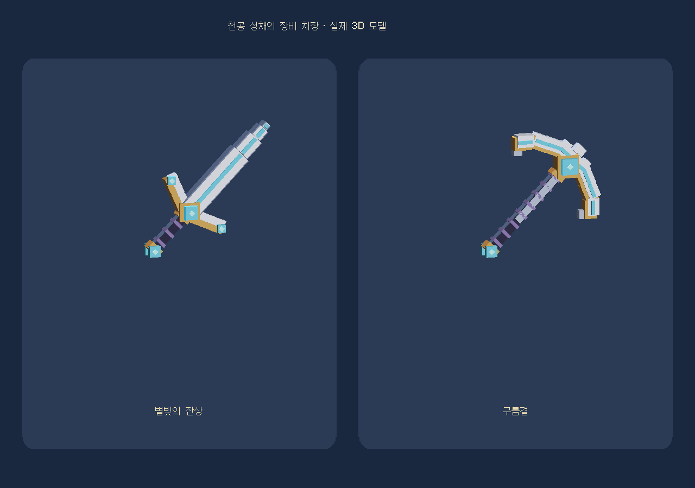

# Sunlit · 모험가의 수첩

Minecraft 1.20.1 / Forge 47.3.0 · **0.5.3 · 입체 치장 모델 개선**

- [시안 JAR 다운로드](https://github.com/supgoodlulu-star/sunlit/raw/refs/heads/main/downloads/sunlit-journal-core-0.5.3-dev.jar)
- [시안 소스 ZIP 다운로드](https://github.com/supgoodlulu-star/sunlit/raw/refs/heads/main/downloads/Sunlit_Journal_ALPHA5_3_Celestial_Skins_Source.zip)
- [현재 건축 시안·입장·범위](CITADEL_PREVIEW.md)
- [수첩 전체 기능·설정](README_한국어.md) · [검증 범위](VALIDATION.md)

[검·곡괭이 스킨 안내](SKINS.md)

제공된 레퍼런스의 백색 첨탑·급경사 지붕·아치와 장미창·공중의 푸른 구체·섬 아래 물줄기를 기준으로 중앙 건축을 새로 설계했습니다. 본당과 보상 연결은 작동하며 일부 높은 탑은 외관 조형입니다. 실내와 주변 지역까지 완성된 전체 맵으로 표시하지 않습니다.

기존 JAR을 교체하고 재시작한 뒤 별길 나침반을 일반 우클릭합니다. 이전 지도 안에 있다면 먼저 귀환하세요. 기존 지도와 개인 칭호·스킨은 보존합니다. 서버와 접속자 모두 같은 버전을 사용합니다.

프로필·생활 기술·업무·공동 축제·칭호 채팅·키/쉬프트 우클릭 열기와 치장 보관 기능을 유지합니다. `/sunlit journal`로 수첩을 엽니다.
