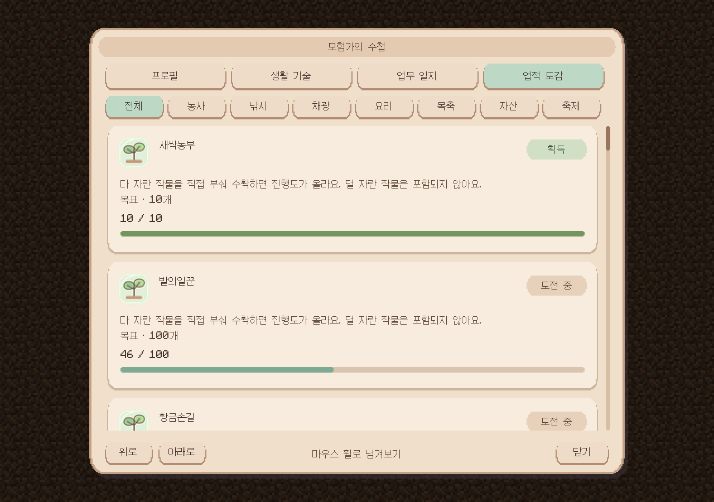
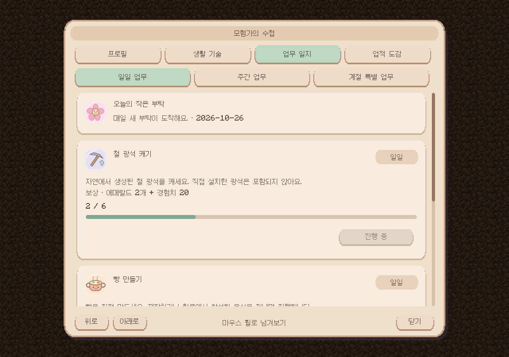

# Sunlit · 모험가의 수첩

Minecraft 1.20.1 / Forge 47.3.0용 **0.4.4 개발 버전**입니다.

- [설치용 JAR 다운로드](https://github.com/supgoodlulu-star/sunlit/raw/refs/heads/main/downloads/sunlit-journal-core-0.4.4-dev.jar)
- [통합 소스 ZIP 다운로드](https://github.com/supgoodlulu-star/sunlit/raw/refs/heads/main/downloads/Sunlit_Journal_ALPHA4_4_Integrated_Source.zip)
- [설치 방법·기능·업무 설정](README_한국어.md)
- [검증 범위](VALIDATION.md)

기존 Sunlit JAR을 제거한 뒤 새 JAR을 `mods` 폴더에 넣으세요. 호스트와 접속자 모두 교체합니다. 수첩은 `/sunlit journal` 또는 **웅크린 상태로 허공 우클릭**으로 엽니다. 설정 → 조작 → 모험가의 수첩 → 프로필 열기에서 전용 키도 지정할 수 있습니다(기본 미지정).

이번 버전은 대표 칭호를 채팅 닉네임 앞에 표시하고, 수첩과 채팅에 칭호별 테마 색을 적용합니다. 채팅 본문과 기존 닉네임 색은 유지합니다. 탐험·생활·서적에 서로 다른 아이콘을 사용하며, 업무 일지를 일일·주간·계절 특별 업무 탭으로 나눴습니다. 업무는 지정된 작물·물고기·광석·음식·동물만 집계합니다. 표시할 수 없는 연동 정보의 진단 문구는 화면에서 생략합니다.

[실제 칭호 프로필 검사 화면](validation/screenshots/input-profile-themed.png) · [실제 채팅 왕복 검사 화면](validation/screenshots/input-chat-themed.png)

아래는 실제 Minecraft 클라이언트에서 **예시 데이터**로 촬영한 UI입니다. 실제 모드팩 플레이나 계절·경제 연동 검증 결과는 아닙니다.

