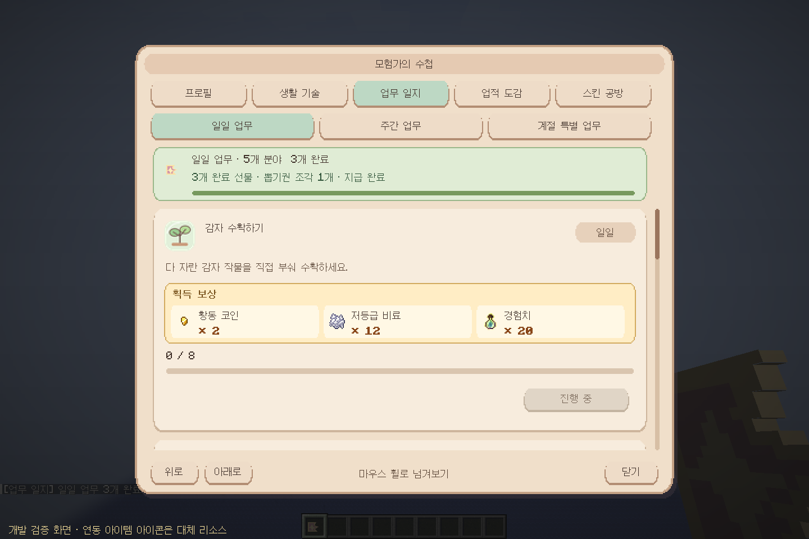
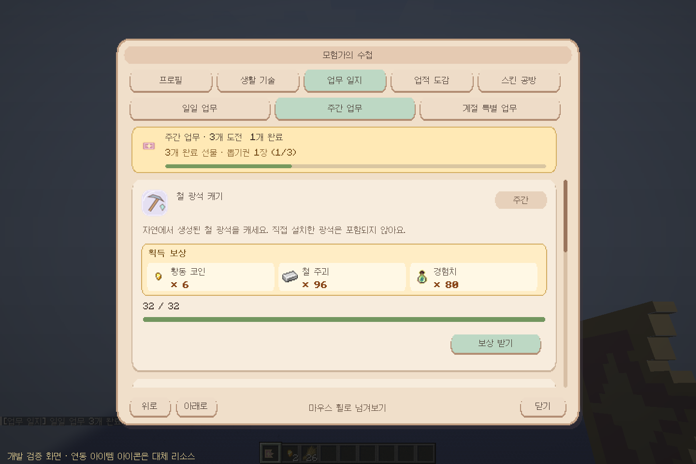

# 0.7.0 · 협의한 업무 보상

## 업무 수와 공통 보상

- 일일: 농사·낚시·채광·요리·목축에서 하나씩 **5개**, 개별 보상은 **황동 코인 2개 + 경험치 20 + 재료 1종**.
- 주간: 서로 다른 분야 **3개**, 개별 보상은 **황동 코인 6개 + 경험치 80 + 재료 1종**.
- **일일은 임의의 3개 완료 시 조각 1개**. 5개 전부를 완료할 필요가 없고, 4·5번째 완료로 조각이 추가 지급되지 않습니다.
- **주간 3개 완료 시 뽑기권 1장**, **조각 10개 → 뽑기권 1장**.
- 화폐는 `numismatics:cog` 실제 아이템이며 은행 계좌에 직접 적립하지 않습니다.
- 개별 업무 보상은 직접 수령, 3개 완료 선물은 자동 지급입니다. 계절 축제의 기존 공동 보상은 이번 변경 대상이 아닙니다.

## 랜덤 재료

각 후보의 확률은 같은 분야 안에서 동일합니다. 후보가 3개면 각 1/3, 2개면 각 1/2입니다. 목축은 같은 먹이의 수량이 무작위입니다.

| 분야 | 일일 후보 중 1개 | 주간 후보 중 1개 |
|---|---|---|
| 농사 | 저등급 비료 12 / 약한 비료 12 / 보습 비료 14 | 저등급 비료 36 / 약한 비료 36 / 보습 비료 42 |
| 목축 | 동물 먹이 18 / 22 / 26 | 동물 먹이 54 / 66 / 78 |
| 낚시 | 지렁이 18 / 게잡이 통발 미끼 14 | 지렁이 54 / 게잡이 통발 미끼 42 |
| 채광 | 석탄 64 / 구리 주괴 64 / 철 주괴 64 | 석탄 96 / 구리 주괴 96 / 철 주괴 96 |
| 요리 | 설탕 18 / 소금 18 | 설탕 54 / 소금 54 |

무작위 선택은 **서버가 업무를 생성할 때 딱 한 번** 합니다. 결과를 월드 UUID별 데이터에 저장하며 화면에 실제 아이템·수량을 표시합니다. 새로고침·재접속·미수령 상태로 재추첨하지 않습니다. 개별 업무에는 재료 후보를 한꺼번에 전부 주지 않습니다.

## 표시와 이전 저장 호환

설명과 분리한 금빛 보상 칸에 화폐·재료·경험치를 표시하고, 위에는 3개 완료 선물과 진행도를 고정합니다. 실제 모드팩에서는 해당 아이템의 원본 아이콘을 읽습니다. 위 검증 화면은 전체 팩이 없는 개발 환경이라 **연동 아이템에 대체 아이콘**을 사용했으며, 하단에도 표시합니다.

기존 일일 3개 업무의 인덱스·목표·진행·수령·보너스 지급 기록을 유지하고 빠진 두 분야를 덧붙입니다. 이미 받은 에메랄드 보상은 다시 지급하지 않고 당시 보상으로 표시합니다. 아직 수령하지 않은 업무에는 새 보상 구성을 한 번 저장합니다. 다음 날부터는 일일 업무가 처음부터 5개 분야 순서로 생성됩니다. 날짜와 월요일 주차는 기존 UTC 기준입니다.

## 아이템 식별자와 없는 모드 처리

- 화폐: `numismatics:cog`
- 농사: `dew_drop_farmland_growth:low_quality_fertilizer`, `weak_fertilizer`, `hydrating_fertilizer` (같은 네임스페이스)
- 목축: `society:animal_feed`
- 낚시: `aquaculture:worm`, `crabbersdelight:crab_trap_bait`
- 요리: `minecraft:sugar`, `meadow:alpine_salt`
- 채광: `minecraft:coal`, `minecraft:copper_ingot`, `minecraft:iron_ingot`

화폐와 선택된 재료 모두 등록되어 있어야 수령합니다. 빠진 아이템이 있으면 코인·경험치를 먼저 주거나 완료 플래그를 소비하지 않습니다. 부족한 설치를 다른 재료로 몰래 대체하지 않습니다. 64개 초과 지급은 정상 스택 크기로 나누고, 인벤토리가 가득 차면 플레이어에게 귀속된 드롭으로 전달합니다.

## 검증 범위

Forge 서버 GameTest 32개, 실제 클라이언트/통합 서버의 5번째 업무 C2S 수령·주간 96개·화폐 동기화·3개 보너스·배율 2/3 화면 검사를 수행했습니다. 누락 아이템의 부분 지급 차단과 이전 3개 업무의 마이그레이션도 검사합니다.

현재 제공된 환경에는 전체 Sunlit Valley 팩과 Numismatics/Dew Drop/Aquaculture 등의 실제 JAR이 없습니다. 경제 아이템의 원본 ID는 조사한 공식 팩 소스와 대조했으며, 런타임 지급 검사는 테스트 전용 아이템 대체물로 실행했습니다. 실제 전체 팩에서의 아이템 동작·아이콘·은행 처리까지 검증했다고 주장하지 않습니다. 테스트 대체 클래스·리소스는 배포 JAR에 포함하지 않습니다.
