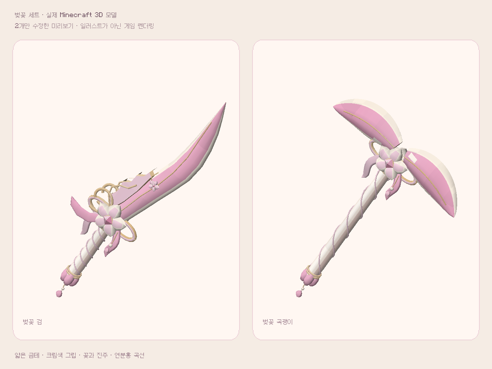

# 벚꽃 검·곡괭이 · 레퍼런스 맞춤 미리보기

사용자가 올린 A/B/C 레퍼런스 중 B의 섬세한 파스텔 벚꽃 방향을 맞추기 위한 **2종 샘플**입니다. 나머지 58종을 완성하거나 같은 스타일로 바꾼 배포가 아닙니다. 기본 main 배포에 병합하지 않고 별도 preview 브랜치에서 검토합니다.

## 바꾼 기준

- 짙은 자주색·큰 픽셀 블록 대신 크림·연분홍·따뜻한 금색.
- 가늘고 길게 휘어진 칼날. 곡괭이는 2차 피드백에 따라 날 폭과 앞뒤 두께를 늘리고, 양끝을 크게 내리던 곡선을 완만하게 폈습니다.
- 크림색 외곽 안에 얇은 금선과 분홍 중심을 겹친 입체 날.
- 검 왼쪽 윤곽에 꽃잎 모양의 금테 칼날 장식와 열린 금빛 소용돌이, 옆으로 흐르는 리본을 보강했습니다.
- 큰 꽃 브로치, 분홍 다이아몬드 컷 보석, 고리형 리본과 흐르는 꼬리.
- 크림색 그립의 가는 분홍 끈, 꽃봉오리 끝장식, 작은 진주·꽃잎 펜던트.
- 앞뒤 모두 마감한 꽃 장식과 닫힌 단면을 가진 실제 3D 메시.

이 이미지는 새로 생성한 컨셉 일러스트가 아니라 실제 게임의 아이템 렌더링입니다. 비교용 밝은 화면은 개발 검증용이며 일반 수첩에 새 메뉴로 넣은 화면은 아닙니다. 원본 그림의 반투명 보석·광택·조명을 Minecraft 기본 렌더러에서 완전히 동일하게 재현했다고 주장하지 않습니다. 먼저 이 샘플의 비율·색·장식 방향을 확인한 뒤 나머지 테마로 확대합니다.

## 직접 보기

[미리보기 JAR 다운로드](https://github.com/supgoodlulu-star/sunlit/raw/refs/heads/preview/sakura-reference/downloads/sunlit-journal-core-0.7.2-sakura-preview.jar)

기존 Sunlit JAR과 교체해서 사용하며 두 JAR을 동시에 설치하지 않습니다. `/sunlit gacha`에서 벚꽃 테마의 검·곡괭이를 선택하면 소유하지 않았어도 외형을 미리 볼 수 있습니다. 소유한 스킨은 기존 ID인 `sakura_sword`, `sakura_pickaxe`로 적용합니다. 모든 보유 기록·뽑기 확률·업무 보상 Java 로직은 0.7.0 그대로이며 다른 58개 모델도 원본과 동일합니다. 히든맵은 추가하지 않습니다.

## 검증과 원본

- `REFERENCE_CHECK PASS`: 실제 두 baked 모델이 새 재질을 읽는지, 검/곡괭이의 서버 소유 검증과 장착 적용, 클라이언트 아이템 태그 동기화, 비교/손에 든 화면 촬영.
- OBJ·UV·텍스처와 연결 검사, 다른 58개 모델의 원본 바이트 동일성 확인.
- 새 생성기는 `tools/reference_sakura.py`, 새 재질은 `models/fantasy/sakura/reference_materials.mtl`, `textures/item/fantasy_materials/sakura/reference_*.png`입니다.
- 서버 경제 로직을 수정하지 않았으므로 기존 0.7.0의 32개 GameTest를 이번에 다시 실행했다고 표시하지 않습니다. 전체 사용자 모드팩/셰이더/Essential 검증도 아닙니다.
- 미리보기 비교 화면/검사 클래스와 경제 아이템 테스트 대체물은 배포 JAR에서 제외합니다. 실제 장착 검사는 클라우드의 폐기 가능한 테스트 월드에서 실행했습니다.
