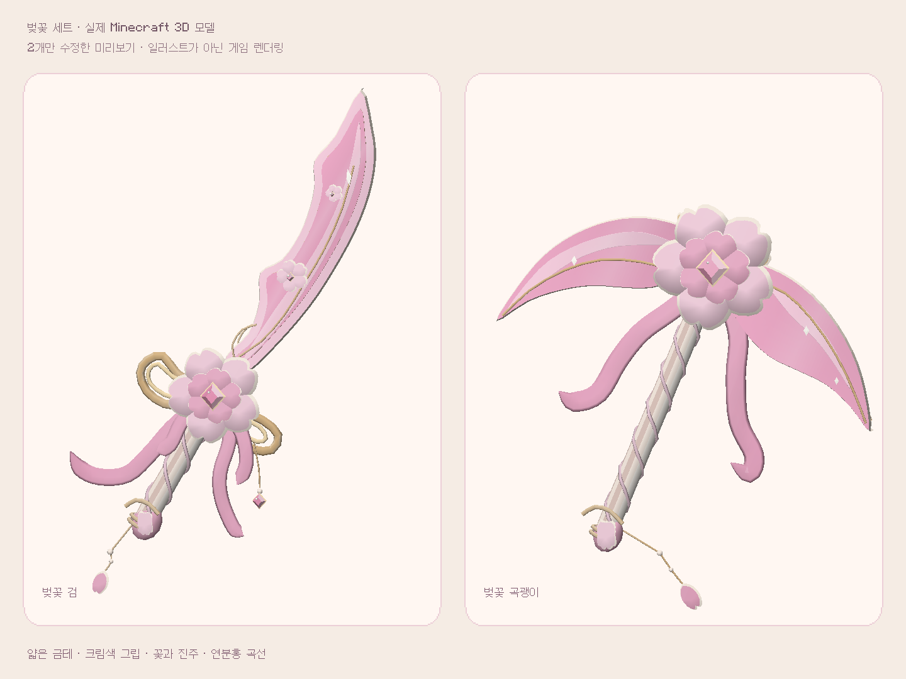

# 벚꽃 검·곡괭이 · 사진 B 윤곽 기준 샘플 (0.7.3)

사용자가 제공한 A/B/C 이미지 중 **B 벚꽃 검과 곡괭이**의 윤곽·비율·장식 배치를 기준으로 두 모델을 다시 구성했습니다. 별도 `preview/sakura-reference` 브랜치의 미리보기이며 기본 main 배포와 다른 58종은 변경하지 않았습니다.

## 이번 변경

- 검: 사진의 비대칭 곡선, 왼쪽 오목한 칼날 어깨, 크림색 외곽·금선·분홍 면을 하나의 닫힌 입체 날로 구성했습니다. 왼쪽 굴곡은 따로 붙인 장식판이 아닙니다.
- 곡괭이: 사진의 넓은 비대칭 꽃잎형 날을 기준으로 만들었습니다. 날 폭과 양끝의 위치를 사진의 배치에서 가져왔습니다.
- 꽃: 노치가 있는 큰 꽃잎 다섯 장, 작은 안쪽 꽃잎 다섯 장, 앞으로 돌출된 분홍 보석과 금테. 앞뒤 모두 입체 마감했습니다.
- 손잡이: 크림색 둥근 그립, 분홍 교차 끈, 금색 고리, 꽃봉오리 끝장식과 진주·꽃잎 펜던트.
- 리본: 사진의 긴 꼬리와 열린 금빛 고리 위치에 맞췄습니다. 칼날 안쪽에도 작은 꽃을 배치했습니다.
- 칼날 곡면의 금테는 꼭짓점마다 안쪽으로 간격을 계산해 폭을 유지합니다. 오목한 날에서 겹치던 면과 늘어난 텍스처 반짝임을 수정했습니다.
- GUI 각도를 검 30도, 곡괭이 약 22.65도로 맞춰 참고 그림의 윤곽을 볼 수 있습니다. 손에 들기·액자 등 기존 7개 표시 방식은 유지합니다.

위 이미지는 실제 게임에서 구운 OBJ 모델을 렌더링한 화면입니다. 사용자 사진을 평면 이미지로 붙이거나 컨셉 이미지를 결과물로 표시한 것이 아닙니다. 원본 일러스트의 붓질·반투명·광택과 Minecraft 기본 조명의 표현에는 차이가 있습니다. 외형의 최종 판단은 사용자 검토가 필요합니다.

## 다운로드와 확인

[0.7.3 미리보기 JAR 다운로드](https://github.com/supgoodlulu-star/sunlit/raw/refs/heads/preview/sakura-reference/downloads/sunlit-journal-core-0.7.3-sakura-preview.jar)

기존 Sunlit JAR을 교체해 사용합니다. 같은 모드를 두 개 동시에 넣지 않습니다. `/sunlit gacha`에서 벚꽃 검·곡괭이를 선택하면 미소유 상태에서도 외형을 볼 수 있습니다. 기존 스킨 ID·보유 기록·뽑기 확률·업무 보상은 그대로입니다. 히든맵은 추가하지 않았습니다.

## 검증

- `REFERENCE_CHECK PASS`: 실제 두 모델이 새 재질을 읽는지, 검과 곡괭이의 서버 소유 검증 및 장착, 클라이언트 태그 동기화, 비교 화면과 손에 든 화면 촬영.
- OBJ·UV·텍스처·연결·두께 검사, 다른 58개 OBJ의 바이트 동일성 확인, 일반 배포 빌드 성공.
- 생성기: `tools/sakura_reference_geometry.py`의 수동 윤곽 좌표와 입체 메시 생성, `tools/reference_sakura.py`의 전용 재질. 사용자 원본 이미지 픽셀은 JAR에 포함하지 않습니다.
- 검사와 촬영은 클라우드의 폐기 가능한 테스트 월드에서 실행했습니다. 검사 클래스 및 테스트용 경제 대체 아이템은 배포 JAR에 포함하지 않습니다.
- 서버 보상 로직은 변경하지 않았으므로 기존 0.7.0의 32개 GameTest를 이번 변경으로 다시 실행했다고 표시하지 않습니다. 전체 사용자 모드팩·셰이더·Essential 검증은 아닙니다.
