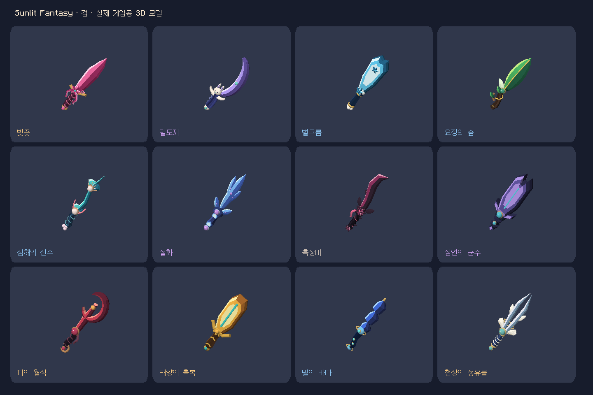
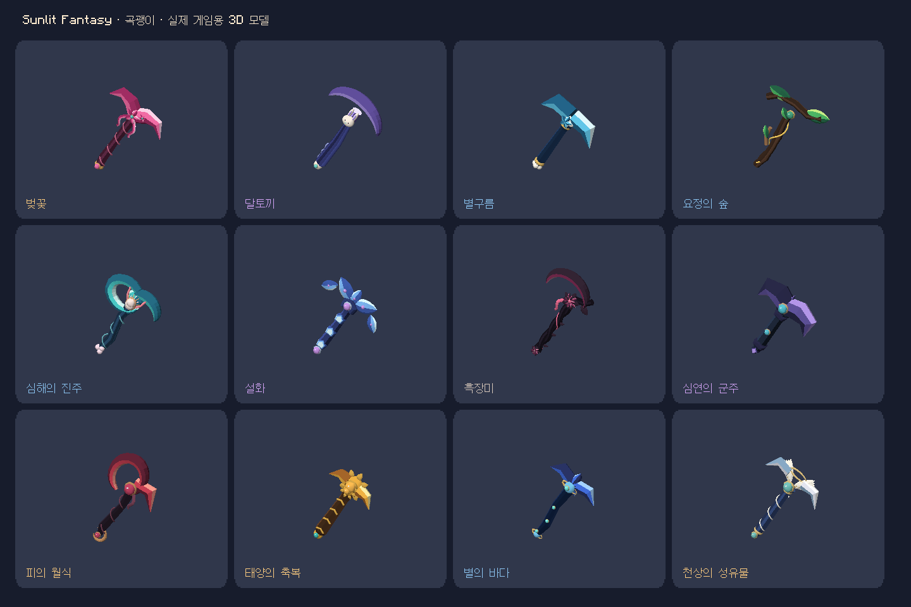
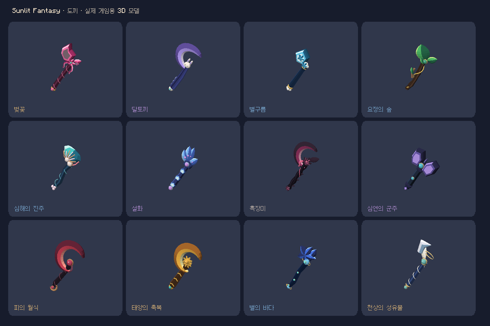
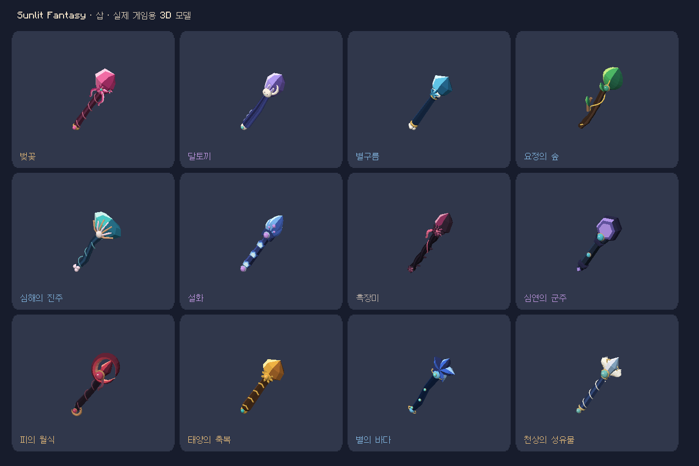
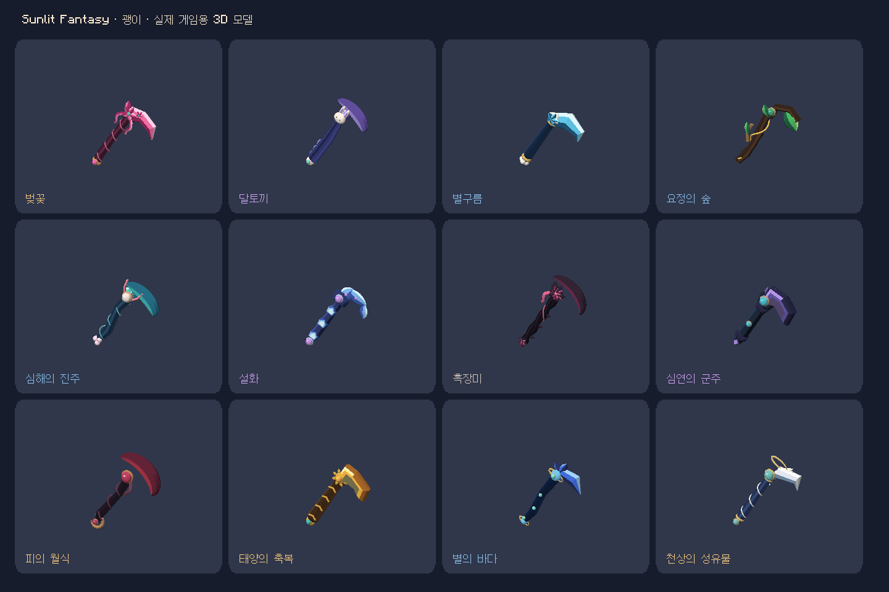

# 0.6.1 · 테마별 입체 조형과 색감

아래 이미지는 실제 Minecraft에서 현재 배포 모델을 렌더링한 화면입니다. 컨셉 이미지가 아닙니다.

## 바뀐 조형

| 테마 | 도구 머리 | 손잡이와 색 |
|---|---|---|
| 벚꽃 | 비대칭 꽃잎 칼날·꽃잎 곡괭이·넓은 꽃잎 도끼 | 자줏빛 감은 그립, 코럴 핑크·밝은 분홍·민트 보석 |
| 달토끼 | 휘어진 초승달 검·둥근 초승달 머리·오목한 곡선 | 통통한 남보라 그립, 라벤더·크림·청록 |
| 별구름 | 구름 크라운 대검·두꺼운 블록형 머리 | 짧고 굵은 남색 그립, 청록·하늘·레몬색 별 |
| 요정의 숲 | 큰 잎·휘어진 가지를 머리 형태로 사용 | 나뭇가지와 덩굴, 짙은 목재·초록·황금빛 잎맥 |
| 심해의 진주 | 부푼 조개 그릇·볼록한 부채날·물결형 검 | 휘어진 청색 그립, 터키색·산호색·진주 |
| 설화 | 여러 갈래 수정 군집과 빙정 단면 | 육각 수정 그립, 진한 남청·밝은 얼음·보라 |
| 흑장미 | 굽은 가시 검·비대칭 낫형 곡괭이 | 땋은 어두운 덩굴, 검자주·장밋빛·코퍼 |
| 심연의 군주 | 끝이 갈라진 육중한 대검·쌍날 대형 도끼 | 짧은 육각 금속 그립, 암회색·보라·청록 보석 |
| 피의 월식 | 고리형 검날·끊어진 고리와 갈고리 | 붉은 띠를 감은 그립, 검자주·진홍·호박색 |
| 태양의 축복 | 넓고 각진 대검·태양 원반 머리 | 굵은 금속 그립, 짙은 동색·금색·청록 상감 |
| 별의 바다 | 세 부분으로 나뉜 검·별 모양 도끼와 삽 | 굽은 남색 그립, 코발트·은하색·밝은 청록 |
| 천상의 성유물 | 두 갈래 검날·겹친 깃털을 실제 머리로 사용 | 감은 청회색 그립, 은백색·금색·비취색 |

칼날은 평면 윤곽을 얇게 늘인 구조에서, 단면을 가진 곡선 메시와 볼록한 조형으로 변경했습니다. 중앙 융기·모따기·측면에 다른 색을 배치하고, 그립과 머리의 두께·비율·배치를 테마별로 나눴습니다. 꽃·날개·보석도 입체 소켓과 몸체에 연결됩니다.

## 실제 게임 모델 비교

### 검

### 곡괭이

### 도끼

### 삽

### 괭이

## 유지한 동작

- 60개 스킨 ID·수집·장착 기록, 바닐라 30종 장비 연결, 능력치·내구도·이름·인챈트 보존.
- 일일 업무 3개 완료: 조각 1개 / 주간 업무 3개 완료: 뽑기권 1장 / 조각 10개: 뽑기권 1장.
- 기존 뽑기 확률·중복 별가루·선택 교환, 히든맵 제외 설정.

## 검증과 원본

`tools/fantasy_sculpture.py`는 12개 테마의 몸체와 그립을 조형하며, `tools/generate_fantasy_collection.py`가 OBJ·재질·모델 바인딩을 출력합니다. `tools/validate_fantasy_sculpture.py`는 장식 그룹을 제외한 머리와 손잡이 두께, 대비 재질, 머리 윤곽 중복을 검사합니다. 이 수치 검사는 미적 품질 평가를 대신하지 않습니다.

실제 모델은 60종 합계 약 14.6만 삼각형으로 이전 약 32.7만 개보다 적습니다. 프레임 성능이 모든 환경에서 향상되었다고 측정한 결과는 아닙니다. PBR 재질이나 사용자 셰이더를 요구하지 않습니다.
